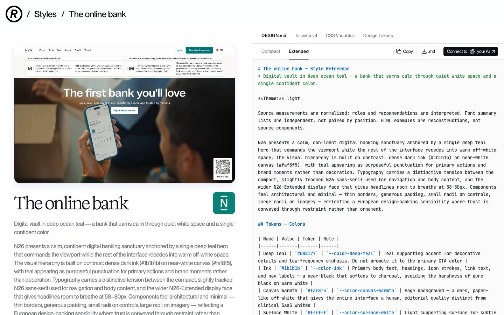
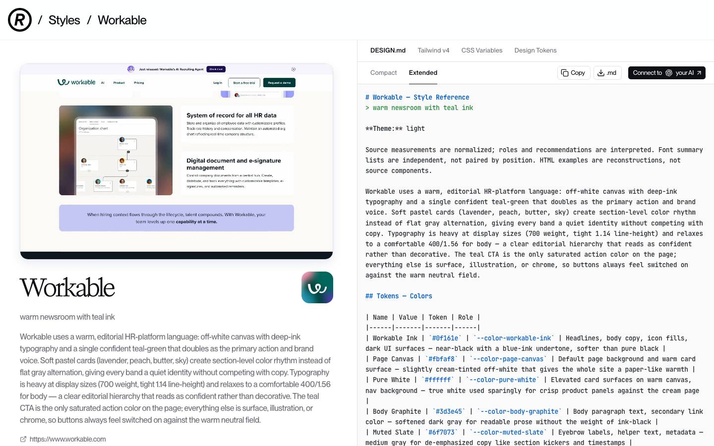
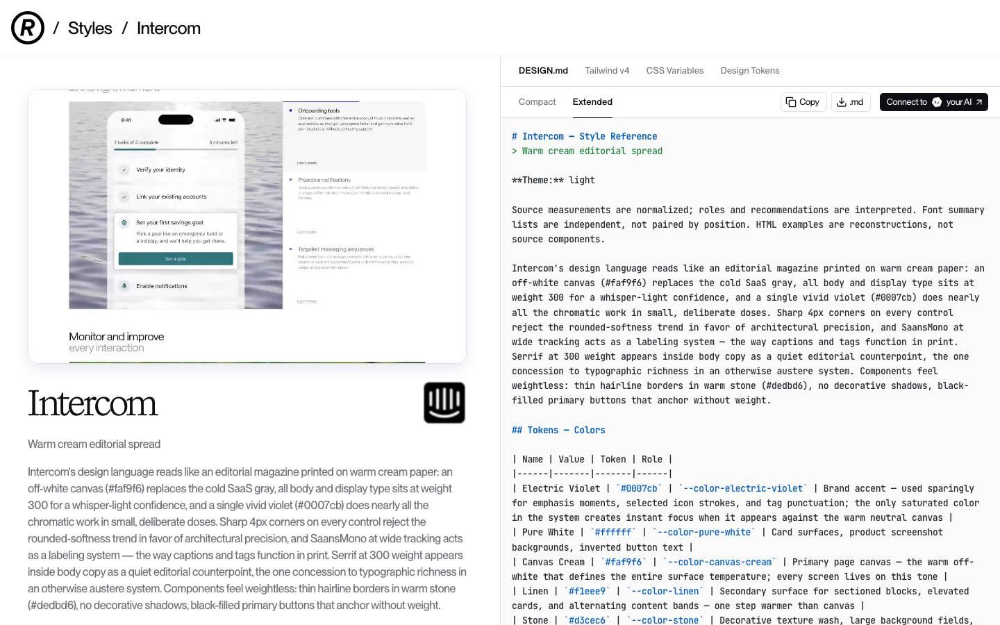
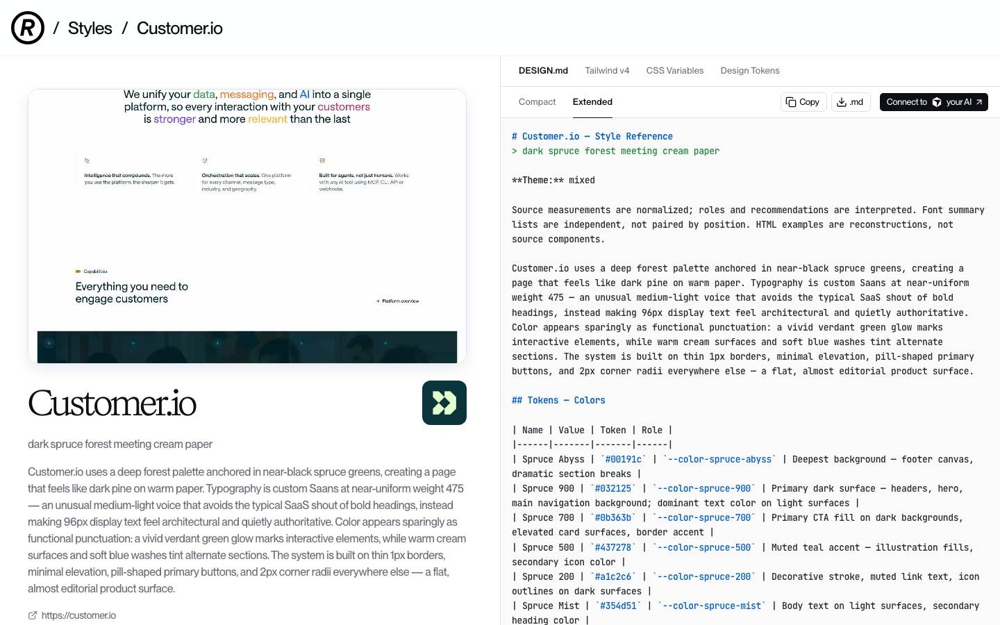
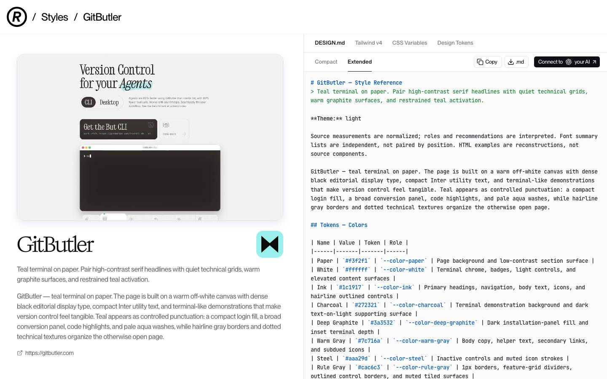

# Klaket UI direction (for approval before restyling)

**Status:** draft, 2026-10-25, on branch `feature/klaket-identity`. The checkpoint tag is `pre-klaket-identity`.

**What stays fixed:** Klaket's four colours (teal `#0F5C57` with `#0A3F3C`, ink `#121212`, paper `#F6EBD9`, signal `#F2483A`) and its four fonts (Cairo, IBM Plex Sans Arabic, IBM Plex Sans, IBM Plex Mono) always win. The references below supply **layout, components, spacing and interaction patterns only**, never their colours, fonts or logos.

## The five references
| # | Reference | What we take | Where it goes in Klaket |
|---|---|---|---|
| 1 | **N26**, "Digital vault in deep ocean teal"  | One colour leads and everything else recedes. Layering comes from **surface contrast only, never shadows** (canvas → white card → tinted panel). Compact controls with an **8px radius**, image cards at 24px. Generous page headers. On a teal panel, the button is the inverse one (paper button, teal text). | The app shell: rail and top bar, page headers, primary and secondary buttons, brand panels (sign-in, client portal hero), light-mode surfaces. |
| 2 | **Workable**, "Warm newsroom with teal ink"  | A workflow product run on **one** action colour: buttons are either teal-filled or teal-outlined, never a third style. **Cards at 16px, buttons at 8px**: soft cards, crisp buttons. Small **caps eyebrow labels** above headings. An 8px spacing base with roomy section gaps. | Lists and pipelines (Productions, approvals, Home cards), the Brief form and New project, section rhythm. Their pastel card rotation becomes **paper and teal tints**, since we add no new hues. |
| 3 | **Intercom**, "Warm cream editorial spread"  | A conversation product on cream paper. **Monospace as a labelling system:** 12px mono tags with wide tracking, like print captions. Hairline borders, no decorative shadows. The accent used **at most once or twice per screen**. | Comments and approval threads, notifications ("from the slate"), the client portal, and the **mono label system** (`SCENE 04 · TAKE 12 · 06:40`, production codes, department tags) in IBM Plex Mono 500. Intercom's one-accent rule matches our **one signal-red element per screen**. |
| 4 | **Customer.io**, "Dark spruce forest meeting cream paper"  | Near-black and deep green surfaces against warm cream, **flat with 1px hairlines**. **Pill buttons** (fully rounded) reserved for one job. **4px focus rings** instead of outlines. Clear spacing tiers (24 / 32 / 96). | **Dark mode:** ink canvas, `#1C1C1C` cards, `#0A3F3C` brand bands, paper text. Inverted brand sections. The 4px focus ring in both modes. Pill shape only for **bubble-word chips and status pills**. |
| 5 | **GitButler**, "Teal terminal on paper"  | Teal as **controlled punctuation** in technical screens. **1px rule-line grids** with 8px outer corners. Terminal-like panels for machine output. | The data-dense production screens: AI Breakdown, Shot List, Stripboard, Call Sheet, Budget tables. Hairline grids, mono figures, teal only on the active row or action. The **AI's output** (suggestions, transcript lines) appears in a quiet "terminal" style panel. |

**Bonus, Superhuman:** large photography framed edge to edge with a dark surround. Used for the Treatment & Lookbook and Storyboard presentation modes; the pictures themselves stay untouched.

## The resulting system, proposed
- **Radius:**
  - 8px for buttons, inputs, selects and tabs.
  - 16px for cards and panels.
  - 24px for large brand panels and image cards.
  - Fully rounded only for bubble-word chips and status pills.
  - One scale, taken from N26 and Workable. Intercom's 4px and Customer.io's 2px are left out on purpose, so the app doesn't feel like three products.
- **Depth:** no shadows except on floating layers (menus, dialogs, toasts). Cards separate from the canvas by surface colour and a 1px hairline.
- **Spacing:** a 4px base with 8 / 16 / 24 / 32 steps. 24px gaps inside panels, and 48–64px between major page sections.
- **Type roles:**
  - **Cairo 900** for page titles and bubble words (English in capitals).
  - **Cairo 700** for section headings.
  - **IBM Plex Sans** (English) and **IBM Plex Sans Arabic** (Arabic) at 400/600 for UI and body text.
  - **IBM Plex Mono 500**, 12px with +0.08em tracking, for codes, scene and take numbers, times and department tags.
- **Signal red:** at most one element per screen. That's the key action (ink text on red), an unread dot, or an "بانتظارك / Waiting on you" badge. Never red text on the light canvas, which is 3.4:1 and fails.
- **Bubble words:** the official word list as status chips, toasts, notification titles and empty states. One talking bubble per screen.

## Tokens and contrast, pre-checked
| Token | Light | Dark | Checked |
|---|---|---|---|
| `--bg` | `#FBF5EC` (lighter paper) | `#121212` | — |
| `--surface` | `#FFFFFF` | `#1C1C1C` | — |
| `--surface-brand` | `#0F5C57` | `#0A3F3C` | paper on them: 6.6 / 9.9 |
| `--text` | `#121212` | `#F6EBD9` | 17.3 / 15.9 |
| `--text-muted` | ink 62% (`#6B6865`) | paper 65% (`#A69F93`) | 5.1 / 7.1 |
| `--border` | ink 12% | paper 12% | hairline |
| `--primary` / `--on-primary` | `#0F5C57` / `#F6EBD9` | same | 6.6 |
| `--link` | `#0F5C57` | **`#5FA8A1`** (teal tint) | 7.2 / 6.8 |
| `--signal` / `--on-signal` | `#F2483A` / `#121212` | same | 5.1; **white on red is 3.6, which fails, so we use ink on red** |

**Status colours:**
- **Approved:** teal.
- **Attention / blocked:** signal red.
- **Draft / neutral:** paper and ink tints.
- **Warning:** the four colours have no separate warning colour. **Proposal:** use an ink-tinted outline pill with a mono "!" label, rather than adding a hue.

## Logo: what the identity page gave us
Extracted to `docs/brand/identity-source/` from the identity page's inline SVGs. None of them contain scripts.
- **Wordmarks:** ink and cream.
- **App icons:** teal, and dark.
- **Lockups:** horizontal on teal, and vertical on ink.
- **Mark:** the version with a bubble word.
- **The guide's own images:** clear space (2X, where X = the thickness of the slate bar), minimum sizes, the six colour versions, misuse, proportion, and the word list.

**Not on the page:** a standalone mark file. I'll cut it from the app icon, using the colour versions the guide shows.

**Please send the official brand kit** (SVG, PNG and the MP4 motion). It will drop in as a file replacement.

## Questions before I restyle
1. **Pill buttons:** your brief lists Customer.io for "pill buttons". I propose pills **only** for bubble-word chips and status pills, with 8px buttons everywhere for consistency. Should primary buttons on the sign-in and brand panels be pills too?
2. **Warning colour:** go with the ink-outline "!" proposal above, or do you want a tint?
3. **The mark on light backgrounds:** use the guide's "on paper" version (teal body, ink stripes, red dots). The guide shows this; please confirm it's the one you want in the light-mode rail.
